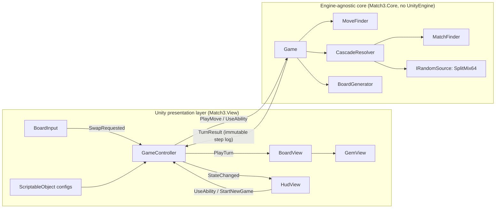
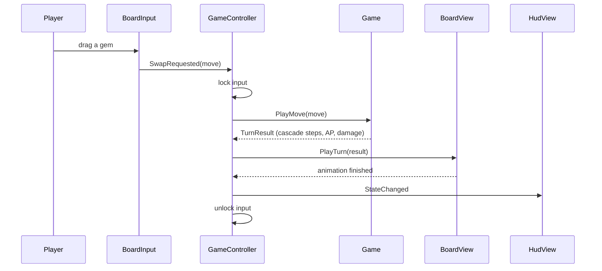

# Match-3 Combat

[](https://github.com/michael-gambardella/match3-combat/actions/workflows/ci.yml)

A match-3 battle game in the style of *Marvel Puzzle Quest*: matching gems earns action points of that color, which
pay for abilities that damage an enemy before the turn limit runs out. Built as an **engine-agnostic C# core** with a
**thin Unity 6 presentation layer**.


## Highlights

- **All game rules live in a plain C# library with no Unity dependency**, enforced by the compiler
  (`noEngineReferences`). Unity only plays back results, so every rule is testable in milliseconds without the editor.
- **{{TEST_COUNT}} tests, {{LINE_COVERAGE}} line coverage** of the core, including **{{PROPERTY_COUNT}} FsCheck property
  tests** that check each rule against a brute-force definition on about {{PROPERTY_CASES}} random boards per run.
- **Fully deterministic.** A seeded SplitMix64 generator drives board generation, refills, and reshuffles. Every game
  logs its seed, and a golden replay test pins a full 30-turn game, so replays and bug reports reproduce exactly.
- **Algorithms worth reading:** union-find match merging, single-pass gravity, constant-time move validation (proved
  equivalent to a full rescan by a property test), and boards generated match-free by construction.
- **Designer-tunable** through ScriptableObjects: combat rules, abilities, and a gem palette that gives each color a
  distinct shape for colorblind players. Invalid values show the core's own validation errors in the Inspector.
- **CI on every pull request:** formatting, a zero-warning build with nullable analysis, tests, and coverage.

## Architecture



- **The core computes; the view animates.** A move returns a `TurnResult` holding every cascade step: what cleared,
  what fell where, and what spawned. The view plays those steps back and derives nothing itself. A property test proves
  each step fully explains the next board, and the view checks it stays in sync after every step.
- **One mutable object.** `Game` is the only mutable type in the core; boards, action points, and results are
  immutable. `GameController` is the only code that calls `Game`.
- **Input is locked while a turn animates**, so the player always acts on the board they can see.

### One turn



## Testing

| Kind | What it covers |
|---|---|
| **Unit tests** (xUnit) | Every rule, with boards written as readable text fixtures |
| **Property tests** (FsCheck) | Invariants over random boards and full random games; failures shrink to a minimal board |
| **Golden tests** | Exact boards for given seeds, and a pinned 30-turn replay |

Expected values for fixtures and golden tests were generated by an independent reference implementation of the rules.
Property tests use brute-force definitions as oracles. For example, "a cell is matched exactly when some three-cell
window through it is one color" is checked against the optimized union-find matcher. When a planted bug made the
matcher ignore runs of exactly three, FsCheck shrank the failing 6×7 board down to a single column of three gems.

The Unity layer contains no game logic and is verified manually; see [DESIGN.md](docs/DESIGN.md) for why CI covers
only the core.

## Running it

**Tests** (requires the .NET 10 SDK):

```bash
dotnet test
```

**Game:** open `unity/` in **Unity {{UNITY_VERSION}}**, load `Assets/Scenes/Encounter`, and press Play. Set a seed on
the `GameController` to replay a specific game.

## Project layout

```
src/Match3.Core/            build file for the core (sources live under unity/Assets/Match3/Core)
tests/Match3.Core.Tests/    unit, property, and golden tests
unity/Assets/Match3/
    Core/                   rules: Grid, Matching, Cascades, Moves, Generation, Randomness, Combat
    View/                   presentation: Config, Boards, Gems, Animation, Interaction, Controllers, Hud
    Content/                designer assets: rules, abilities, palette, sprites, prefabs
docs/DESIGN.md              every design decision, with the alternatives rejected
```

## Design decisions

[DESIGN.md](docs/DESIGN.md) records each significant decision, why it was made, and what was considered instead.

## What I'd do next

- **Two-sided combat:** enemy attacks on a timer, with abilities that affect the board.
- **Special gems** from 4- and 5-matches, building on the existing shape-agnostic match representation.
- **Play Mode tests in CI** using GameCI and a Unity license, to cover the presentation layer automatically.
- **Hints** after a few idle seconds, using `MoveFinder.FindLegalMoves`.
- **Gem object pooling**, but only after profiling shows instantiation matters at this scale.